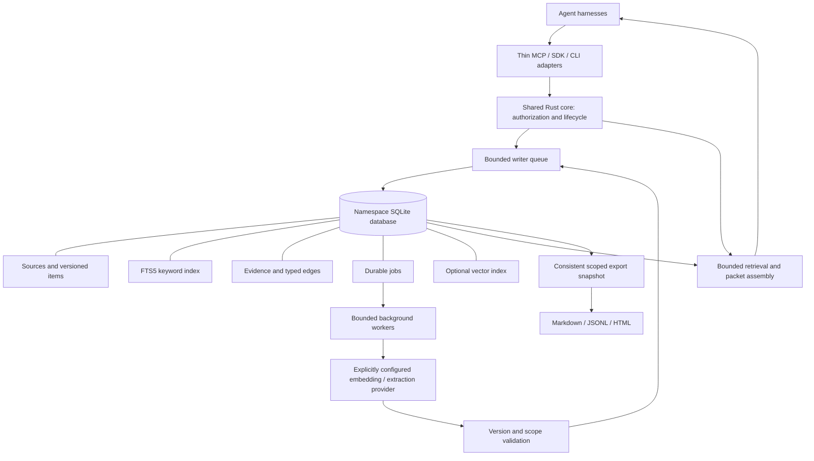
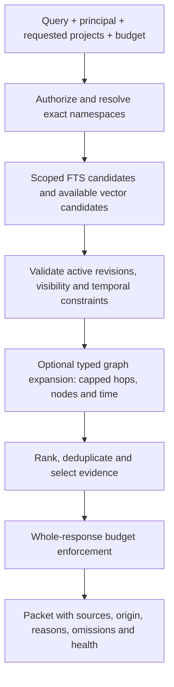

# Memz: standalone memory engine specification

Version: 0.2 draft · Date: 2026-10-14

Status: proposed design, not an implemented or validated system.

## 1. Purpose

Memz gives agent harnesses durable, attributable memory of conversations,
preferences, decisions, procedures, and task progress. It should answer both
“what did we decide?” and “what evidence or incident led to that decision?”
without turning every interaction into a model-driven knowledge-compilation job.

The application is Rust throughout: core library, background worker, local daemon,
CLI, and MCP adapter. SQLite and optional vector/model libraries are embedded
native dependencies; “Rust-based” does not mean rewriting SQLite in Rust.
No Python runtime, external database server, or remote service is required for
capture and lexical retrieval.

All Memz-owned executable code, including adapters, test utilities, benchmarks,
and workflow checkers, is Rust. No Python or Node runtime is introduced into
Memz. SQL, configuration, static HTML/CSS, and embedded native SQLite/vector/model
dependencies are allowed; Rust-only describes application and tooling code, not
a requirement to rewrite SQLite. Planwright itself is external orchestration.

The primary deployment is one user's local machine, with several cooperating
harnesses and separately authorized projects. Multi-host writable database files,
enterprise multi-tenancy, distributed consensus, and unrestricted graph analytics
are outside v1.

### Explicit non-goals

- Sage integration, document expertise compilation, persona simulation, automatic
  belief harmonization, or a collection of alternative retrieval engines.
- Automatic cross-project discovery or inferred permission from graph connections.
- Silent deletion of durable evidence to satisfy an item-count limit.
- Automatic model downloads, remote inference, or external sync.
- A promise of zero bugs or unbounded capacity. Correctness must be expressed as
  contracts and verified against failure cases before release.

Large documents may be accepted through a separate import job. PDF extraction,
OCR, and document parsing are not part of the small-text latency promise.

## 2. Product behavior

1. A harness registers or selects a project and obtains a scoped capability.
2. `remember` commits a small text record and its source metadata immediately.
3. The record is immediately searchable by keyword; enrichment can follow later.
4. `recall` returns a bounded packet of relevant, authorized evidence, including
   origin and selection reasons. The harness controls prompt insertion.
5. `correct` supersedes a revision and invalidates dependent derived content.
6. `forget` removes content from live retrieval and schedules physical cleanup.
7. `inspect`, `export`, and `status` make memory and its health understandable.

Automatic capture is an adapter policy, not a different storage implementation.
Default capture excludes assistant/tool output unless explicitly enabled. When
enabled, these remain labeled as agent/tool-originated material. Memz never
promotes an agent-generated statement to a user-confirmed fact merely because it
was repeatedly retrieved.

## 3. Required invariants

| ID | Contract |
|---|---|
| C1 | A successful capture acknowledgement means source, record, FTS update, idempotency result, and enrichment job have committed together. |
| C2 | No model, embedding, network, or document parsing work runs in the small-text write path. |
| C3 | Scope is enforced before candidate selection, on every traversed edge, and again before returning evidence. |
| C4 | Derivation cannot broaden access. Cache entries, exports, and diagnostics cannot bypass authorization. |
| C5 | Every derived item or relationship retains exact supporting source revisions. A citation proves provenance, not semantic truth. |
| C6 | A correction or deletion committed before a recall starts cannot appear as current content in that recall. |
| C7 | Background work never publishes against obsolete source revisions or permissions. |
| C8 | Durable retention is independent of relevance ranking. Age alone does not delete accepted memory. |
| C9 | Search, traversal, queues, caches, imports, exports, and background work have explicit resource bounds. |
| C10 | All adapters use the same storage, authorization, correction, and retrieval implementation. |
| C11 | Degradation, truncation, queued work, and failures are observable; unavailable is distinct from no matching memory. |
| C12 | Unsupported schema or embedding identity fails explicitly; synthetic data is never a production fallback. |

For overlapping reads and corrections, responses declare their snapshot revision.
A correction acknowledged after a recall has begun may leave that earlier read
with its previous snapshot. Adapters must not reuse it as a fresh result after
observing the correction. Strict callers can require a minimum revision.

## 4. Architecture



Use one Rust workspace, initially with a core library and executable. Separate
modules cover contracts, authorization, store, retrieval, jobs, providers, and
exports. Split crates only when a real dependency boundary warrants it.

The daemon owns database connections and worker pools. Local adapters share it;
they must not independently load a model for every tool call. An embedded mode
may use the same core for a single process. Protocol and database versions are
explicit. The daemon uses a private local socket with OS ownership checks;
there is no public TCP listener in v1.

### Storage choice

Use one SQLite database per registered project namespace, plus distinct optional
personal and explicitly shared namespaces. A small catalog records stable
namespace IDs, registered roots, database locations, and capability grants.
The catalog contains routing metadata, not a global memory-content index.

### Physical state location

All live Memz state belongs under the private home directory `~/.memz/`, never
inside registered project folders or Git worktrees. The default layout is:

```text
~/.memz/
  catalog.sqlite
  namespaces/<stable-namespace-id>/memory.sqlite
  run/                 # daemon socket and ownership/lock metadata
  cache/               # bounded rebuildable data
  exports/             # default explicit export destination
  backups/             # explicit backup jobs and manifests
```

SQLite WAL/SHM sidecars stay next to their database. Database paths derive from
validated opaque namespace IDs, not project names or user-supplied path fragments.
Project roots are catalog mappings only: Git checkout/reset, worktree removal,
or folder moves must not move, delete, or duplicate memory. Root reassignment is
explicit. Namespace directories are owner-only; files and the local socket use
restrictive ownership/permissions. Reject unsafe symlink/path escapes and refuse
to silently adopt an unexpected owner or an incompatible state layout.

A trusted `MEMZ_HOME` override supports isolated tests and deliberate relocation;
normal operation rejects a state directory inside a registered project/worktree.
Tests use disposable roots keyed by `PW_RUN_ID` and never the real home store.
Do not repurpose the operating system HOME variable. Relocation requires a stopped
writer, validated copies/backups, and explicit catalog rebind; startup does not
scan repositories or auto-migrate stray database files. Central storage prevents
Git operations from touching memory; it does not eliminate corruption risk.
Durable commits, integrity checks, recovery, backups, and single-daemon ownership
remain required. This layout concerns Memz state, not Planwright's own database.

This separates project write contention and limits accidental query exposure.
Cross-project recall performs bounded reads against named, authorized databases
and merges results; it is not a cross-database write transaction. Use a bounded
connection cache so project count does not imply unlimited open connections.

FTS5 supplies lexical retrieval. Optional sqlite-vec supplies semantic retrieval;
pin and qualify a compatible extension version rather than installing one at
runtime. Store embedding provider/model/revision/dimension/normalization identity.
An identity change creates a new index generation, never a mixed vector space.

The graph consists of normal indexed tables. Use indexed joins or bounded
recursive queries; a separate graph server is not necessary for this workload.
SQLite recursive queries support graph traversal, while WAL supports concurrent
readers and one writer per database. See [SQLite WITH](https://sqlite.org/lang_with.html),
[FTS5](https://sqlite.org/fts5.html), [WAL](https://sqlite.org/wal.html), and
[sqlite-vec](https://alexgarcia.xyz/sqlite-vec/features/vec0.html).

## 5. Identity and cross-folder isolation

### Namespace resolution

- Project IDs are stable, explicit identifiers with registered canonical roots.
- Resolve symlinks and path boundaries; never authorize by string-prefix matching.
- Nested folders inherit their project unless separately registered. Ambiguous
  overlapping roots require an explicit project selection.
- Moving a folder does not silently create or merge a project; root reassignment
  is an explicit catalog operation.
- The working directory is a resolution hint, not an authorization credential.
- Namespace IDs, filenames, and claimed author fields supplied by a model do not
  grant privileges. The trusted adapter binds the principal and allowed namespace set.

### Visibility

An item is session-private or project-visible within its namespace. Personal and
shared collections require separate grants. Default queries search only the
current project and authorized current-session records.

Cross-project access requires a persisted user-approved grant for named projects
or an explicitly approved one-time request. The intersection of requested and
granted access determines the read; disallowed requests fail without revealing
whether private content exists. Revocation invalidates capabilities and caches.

Every result contains origin namespace, scope, source, and a reason for inclusion.
Cross-project results carry `cross_project: true` and a display label. Adapters
must surface that borrowed context in their UI/transcript; context injection must
also preserve attribution. If an adapter cannot show it, automatic cross-project
injection is disabled.

In v1, derived items and graph edges stay within one namespace and one compatible
visibility boundary. Do not combine different sessions, private and project-visible
records, or different projects into a shared summary. Mixed-scope generation is
rejected rather than relying on a complicated access-intersection implementation.
Cross-project recall can present independently attributed items together without
persisting a merged derivative. Graph links never confer access.

## 6. Logical data model

This is a logical contract, not final migration SQL. Operational tables and search
indexes may supplement it without creating separate competing memory models.

| Record | Required contents |
|---|---|
| `sources` | ID, origin kind, attributable author, external reference, original text or retained passage, content hash, timestamps, namespace/session visibility, source revision and retention class |
| `items` | Stable ID, revision, kind, content, explicit/inferred status, active/superseded/invalid/deleted state, validity interval, source identity, namespace/session visibility |
| `evidence` | Item/edge revision, source revision, exact passage/span or whole-message locator, supporting role, derivation method/version |
| `edges` | Stable ID/revision, from/to item IDs, typed relation, supporting evidence, scope, validity and status |
| `jobs` | Idempotency key, source revisions, job type/version, state, attempts, lease owner/expiry, next attempt, sanitized error and resource accounting |
| `operations` | Client request ID, payload digest, committed result, mutation sequence and timestamps; minimal deletion tombstones contain no removed text |

Item kinds begin with fact, preference, decision, procedure, task, incident, and
entity. Types describe content; they do not create different retrieval engines.
Keep event time, ingestion time, and validity time distinct.

Start with `supports`, `supersedes`, `contradicts`, `applies_to`, `requires`, and
`mitigates`. Evidence attribution is mandatory for inferred edges. Explicit edges
record the user assertion as evidence. Record directions and qualifiers; traversal
against an edge does not reverse its meaning.

Index both edge endpoints with relation/status and the visibility fields needed
by traversal. Ordinary metadata tables use foreign keys and schema constraints.
FTS/vector virtual-table cleanup also needs application-level maintenance because
ordinary foreign-key guarantees do not cover every extension structure.

Identical text is not sufficient to merge memories. Distinct authors, scopes,
events, or source passages can contain identical text. Retried requests deduplicate
by a scoped idempotency key and matching payload digest. Same key with different
payload is an explicit conflict. Any later semantic dedup preserves all provenance.

## 7. Fast capture and background enrichment

```mermaid
sequenceDiagram
    participant H as Harness
    participant C as Core
    participant D as SQLite
    participant W as Worker
    H->>C: remember(text, scope, request_id)
    C->>C: Authorize, validate, enforce admission limits
    C->>D: Short transaction: source + item + FTS + operation + job
    D-->>C: Commit
    C-->>H: ID, revision, searchable=lexical, enrichment=pending
    W->>D: Claim bounded batch with expiring lease
    D-->>W: Immutable source revision inputs
    W->>W: Embed / selectively extract outside database transaction
    W->>D: Recheck scope and revisions; publish atomically
    D-->>W: Published or obsolete
```

Acknowledgement follows commit, including crash/power-loss durability settings
appropriate to the supported local filesystem. Default WAL writes use
`synchronous=FULL`; do not downgrade durability to achieve a latency target.
Batch/group commit may be explored only while each acknowledgement still waits
for its transaction's durable commit.

The foreground does no embedding availability probes, model loading, network
calls, graph inference, or synchronous maintenance. Explicit known relationships
may be written with the item if the request stays within the operation budget.
The proposed small-write maximum is 64 KiB of text; larger imports use bounded
passage batches and report progress separately. Parsing is never hidden inside
the text-write acknowledgement.

Workers batch embedding requests, reuse the configured model, and process only
selected records for extraction. Prioritize explicit memories, decisions and
corrections; ordinary chatter need not receive full extraction. Selection policy
must be inspectable. Defer low-priority work when foreground requests are busy.

Jobs have leases, retry limits, backoff and deterministic operation identities.
After repeated failure, mark the job failed while preserving the original text
and lexical search. A worker finishing after deletion/correction discards stale
output. Model timeout does not imply native computation has stopped: retain its
resource permit until the actual worker exits, preventing repeated timeouts from
spawning unlimited background work.

If disk, queue or quota admission fails, reject before acknowledgement with an
explicit retryable or quota error. Never accept a memory and silently discard its
source or job. Failed/obsolete jobs and rebuildable indexes may be cleaned under
documented policies; active pending work must not be dropped to hide backlog.

## 8. One retrieval pipeline



Default search returns current valid items. Explicit history/as-of requests may
include superseded revisions, clearly labeled. Explicit current-state slots such
as a confirmed preference resolve to the active revision rather than whichever
old mention has the highest similarity. Conflicting unresolved assertions remain
visible as conflicts; similarity alone cannot select a new authoritative truth.

Merge FTS and vector candidates with one deterministic rank-fusion policy, with
stable tie-breaking. Prefer current explicit statements for current-state queries.
Importance and recency may be bounded secondary signals; they cannot make an
irrelevant candidate relevant. Return per-result selection reasons.

Query embedding is deadline-bound and optional. Reuse a compatible cached query
embedding where available. If unavailable or too slow, return lexical results
with `degraded: ["semantic_unavailable"]`. Do not launch unbounded retries.

Apply scope/validity constraints during candidate discovery wherever supported,
then revalidate before output. Post-filtering an unscoped top-k alone is neither
a complete retrieval strategy nor sufficient isolation. Extension limitations
must be handled through scoped partitions, restricted candidate sets, or an
explicit degraded mode. More returned-candidate limits do not make a full vector
scan cheap; scan cost needs its own measurements and execution deadline.

Graph expansion follows a small relation allowlist relevant to the request, with
a visited set and authorization checks at every step. Default maximum: two hops,
64 added nodes, and a 50 ms graph-work budget. These are provisional limits.
Expose hit limits and partial results; never claim the returned graph is complete.

Response budgeting covers evidence, metadata, reasons, omissions and follow-up
instructions together. Default budget: 2,000 tokens; configurable maximum: 8,000.
Declare the tokenizer/counting method. If no compatible tokenizer exists, use
a conservative serialized UTF-8 byte bound and identify it. Transport envelopes
and duplicated MCP text/structured representations must be accounted for and
documented; adapters cannot pretend the packet is the entire model input.

Keep evidence units whole when possible. Any excerpt carries its exact span and
an explicit truncation flag. Return `inspect` follow-ups for omitted detail.
Empty match sets, denied access, unavailable storage and partial retrieval have
distinct status codes.

## 9. Corrections, forgetting, retention and caches

`correct` requires the expected current revision. The transaction writes the new
revision, supersedes the old one, invalidates affected derived items/edges,
updates searchable state, increments a namespace mutation sequence and schedules
re-enrichment. A stale expected revision returns a conflict. Automatic inference
can propose a correction; it cannot silently replace an explicit user decision.

Large dependency fan-out must not turn correction into an unbounded foreground
transaction. Commit the source revision/status and invalidation sequence first;
read eligibility checks supporting revisions so stale derivatives disappear
immediately. Materialized index cleanup and derivative rebuilds can run in bounded
jobs. The same rule applies to forgetting. Metadata invalidation is authoritative;
a lagging search index must never make obsolete content eligible again.

`forget` first establishes a durable deletion state that excludes the source and
dependent content from all fresh reads. Physical removal follows for originals,
FTS entries, vectors, derived items, graph edges and content-bearing job payloads.
Other valid source support may permit rebuilding a derivative, but the old
derivative is hidden until rebuilt without the deleted evidence.

Logical deletion is not a promise of forensic disk erasure. Historical backups,
existing exports, WAL pages and external copies require a separate documented
retention/erasure policy. Minimal tombstones prevent delayed retries or import
replay from resurrecting deleted content. Idempotency-history expiration must
have an explicit retry window; it cannot silently permit old request replay.

Durable is the default retention class. Temporary records require explicit
expiry. Age-based ranking never implies deletion. Archival is explicit and can
move a namespace into read-only/cold storage; it does not silently omit it from
an explicitly requested archive query. V1 quotas reject writes before data loss.

Caches are bounded and keyed by namespace set, principal/capability revision,
session scope, query/options, mutation sequences and embedding identity. A write,
correction, deletion or permission change makes incompatible cached results
ineligible. Do not cache raw content globally by query string.

## 10. Capacity and responsiveness

Provisional defaults to qualify before release:

| Resource | Initial bound / behavior |
|---|---|
| Concurrent foreground requests | 8 per daemon; bounded admission queue; explicit busy response |
| Writer queue | One per open namespace; both operation-count and byte limits; priority for corrections and deletion |
| Enrichment | 1 model worker initially; bounded batches; explicit resource budget |
| Search candidates | Up to 64 lexical + 64 vector candidates per authorized namespace; aggregate cap across namespaces |
| Cross-project fan-out | Up to 4 explicitly authorized namespaces per request; larger requests require pagination |
| Graph | At most 2 hops and 64 additional nodes, subject to total candidate/time budget |
| Foreground recall deadline | 1 second initially; return permitted partial/degraded results or explicit timeout |
| Small text write target | p95 < 50 ms, p99 < 100 ms for <= 8 KiB payloads, including queueing and durable commit |
| Lexical recall target | p95 < 100 ms on a qualified local reference workload |
| Warm hybrid recall target | p95 < 500 ms including query embedding on the qualified provider/hardware |

These are targets and starting defaults, not measured capability. Record hardware,
filesystem, corpus shape, embedding dimension, concurrency and durability mode
alongside any result. Cold model startup is reported separately and may cause
lexical-only degradation under the same request deadline.

Measure at 10k, 100k and 1m items where feasible, including skewed projects,
high-degree graphs, long evidence, concurrent imports/corrections, cold caches,
and slow providers. Define the supported operating envelope from those results;
do not advertise a maximum size from SQLite's theoretical storage limits.

Telemetry includes ingest/recall p50/p95/p99, writer wait, busy responses, oldest
job age, failed jobs, vector coverage, degraded retrieval rate, visited graph
nodes, truncation rate, cache size, disk usage, WAL size and checkpoint progress.
Metrics contain counts/IDs and sanitized errors, not source text or credentials.

Use passive checkpoint work off the foreground path; monitor readers preventing
progress. Do not run full compaction/vacuum on a foreground request. Stop
low-priority enrichment/export work under pressure and reject new writes explicitly
when durable admission is impossible. Never weaken authorization or durability.

SQLite/vector performance must be revisited if the qualified envelope is exceeded.
Keep a narrow vector-index interface so a different index implementation can be
evaluated later. Do not add multiple production retrieval engines preemptively.

## 11. Public surface and harness contract

Proposed core operations, shared across SDK, CLI and MCP:

| Operation | Contract |
|---|---|
| `remember` | Authorized namespace/session, text, kind, provenance, retention and idempotency key; returns stable ID/revision and enrichment state |
| `recall` | Query, authorized namespace selection, current/as-of mode, graph option, total budget/deadline; returns attributable packet and snapshot revisions |
| `inspect` | Resolve an authorized ID/revision; paginate original evidence, history and relation explanations |
| `correct` | Expected revision, replacement and reason; returns new revision and invalidation status |
| `forget` | Expected target, deletion scope; returns logical-deletion revision and physical-cleanup status |
| `status` | Authorized health, capacity and enrichment state without leaking other namespaces |
| `export` | Explicit authorized namespace/filter selection and format; returns an export job/result manifest |

Only the first five are required on the minimal model-facing tool surface.
Namespace registration and grant administration belong to the trusted CLI/UI,
not an unconstrained model-callable permission tool.

Example logical capture result:

```json
{
  "memory_id": "m_...",
  "namespace_id": "project_...",
  "revision": 1,
  "namespace_revision": 42,
  "durable": true,
  "searchable": ["lexical"],
  "enrichment": "pending"
}
```

Adapter obligations: bind identity, register stable project/session scope, choose
capture roles, preserve result attribution, treat memory as untrusted context,
respect budgets and expose degraded/cross-project status. MCP availability alone
does not guarantee the agent calls memory tools or automatically captures turns.
Define hooks explicitly for each supported harness and keep policy in the core.

A future expertise-provider interface can accept query, authorized collection
selection, deadline and budget and return attributed evidence. It is a reserved
extension boundary only. Do not implement a Sage adapter or make expertise calls
part of current recall.

## 12. Human-readable views and portability

Exports are deterministic renderings of stored data, not LLM summaries.

| Format | Contents and role |
|---|---|
| Markdown | Project index, decisions, preferences, procedures, unresolved conflicts, history, sources and small Mermaid neighborhoods |
| JSONL | Versioned portable records with stable IDs, revisions, scope, evidence, relations and deletion semantics |
| Static HTML | Escaped, searchable local view with timelines, provenance and bounded graph neighborhoods; later milestone |
| SQLite snapshot | Full namespace backup with compatible schema/extension manifest; separate from a filtered content export |

Example layout:

```text
project-memory/
  index.md
  decisions/
  preferences.md
  procedures/
  unresolved.md
  history.md
  sources/
  manifest.json
```

Include export ID, schema/render versions, namespace IDs, snapshot revisions,
creation time, selected filters, content hashes and omitted/inaccessible-content
counts that do not reveal private identities. Items show current versus historical
state and whether they are explicit or inferred. No inaccessible source text is
pulled into an export through a relationship.

Create a consistent authorized export snapshot with short, bounded database work,
then render outside live transactions. Full backups use SQLite's backup facilities
and remain namespace-admin operations; filtered exports must not expose a full
database containing other sessions' private content. Long exports are cancellable,
low-priority jobs with disk limits. See [SQLite Backup API](https://sqlite.org/backup.html).

Use stable safe filenames, escape HTML, disable active source markup, and reject
path traversal on export/import. Cross-namespace exports record a separate
snapshot revision per namespace; they do not claim a globally atomic snapshot.

Markdown is initially a view. Editing it does not silently mutate live memory.
A later explicit import operation validates scope, IDs and revisions, previews
changes, and rejects stale edits or resurrection of deleted content. JSONL restore
requires a manifest and integrity checks. Rebuild derived indexes if incompatible.
Already exported files are external copies; forgetting in Memz cannot recall them.

## 13. Useful follow-on capabilities

After the core contracts pass, add these without putting model work on ingest:

- Session handoff view: current task, decisions, blockers and next steps.
- Retrieval explanation: why a memory appeared and which graph edge contributed.
- Changes since a namespace revision, including corrections and revocations.
- Correction-impact preview showing affected derivatives and relationships.
- Health review with proposed duplicate/conflict/stale-item actions. Do not
  silently apply semantic merges or delete originals.

These are views or explicit background jobs over the same records, not new memory
stores or competing ranking systems.

## 14. Implementation sequence and acceptance plan

No tests, builds, benchmarks or model calls were run for this specification.
The following are future release gates, subject to authorization to implement and
validate. Preserve the existing no-build/no-test constraint until that work is requested.

### Milestone A: durable scoped text memory

Rust core, namespace registration/capabilities, schema migrations, transactional
capture and idempotency, FTS, inspect/correct/forget, minimal CLI/MCP, deterministic
Markdown/JSONL exports. No inference is required for this milestone.

### Milestone B: asynchronous semantic enrichment

Durable leased jobs, one configured embedding provider, versioned vector index,
bounded hybrid retrieval, explicit degradation, source-revision publication checks,
and resource/status reporting. Extraction stays optional.

### Milestone C: useful graph memory

Explicit relationships first; selective inferred relationships only with evidence.
Bounded graph expansion uses the same retrieval path and preserves scope.
Add correction-impact and retrieval explanations. Demonstrate benefit over the
same hybrid pipeline with graph expansion disabled.

### Milestone D: operational qualification and readable viewer

Qualify concurrent load, crash recovery, restore/migration, quotas and forgetting.
Add static HTML and optional handoff/health views after core bounds are measured.

| Acceptance area | Required evidence before claiming support |
|---|---|
| Durability | Inject interruption before/after commit; acknowledged sources survive supported crash scenarios; retry creates no duplicate |
| Isolation | Adversarial cross-project/session queries, edge traversal, exports, caches and permission revocation cannot expose forbidden content |
| Correction/deletion | Concurrent workers and warmed caches cannot republish stale/deleted content; old import/retry cannot resurrect it |
| Jobs | Restart reclaims expired leases; duplicate execution is safe; provider failure preserves lexical search and reports lag |
| Retrieval budget | High-degree/cyclic graphs, large evidence, multiple namespaces and transport overhead stay within declared bounds or return explicit truncation/errors |
| Performance | Measure ingest and recall during simultaneous enrichment/export; report p95/p99, cold/warm behavior, queue depth and resource use |
| Recovery | Restore a snapshot and portable export into a fresh instance; verify provenance, scope, history and deletion behavior |
| Quality | Held-out decisions/preferences/incidents and contradiction/correction questions; compare no memory, lexical, hybrid and hybrid+graph with the same answer model and budget |
| Adapter parity | Identical operations through SDK/MCP/CLI preserve identity, results, correction semantics and disclosure fields |
| Schema evolution | Transactional migration/rollback and unknown-future-schema rejection; no silent best-effort schema mutation on ordinary reads |

Quality reporting must distinguish retrieval evidence quality from the answer
model's behavior. Track irrelevant/stale injection, missed relevant evidence,
unnecessary graph expansions and correct abstention. Record exact configuration
and artifacts. Add complexity only when it improves those outcomes under the
same operating limits.

## 15. Decisions to finalize during implementation

These do not change the agreed product scope:

- Exact Rust SQLite/MCP bindings and pinned compatible SQLite/sqlite-vec versions.
- First optional embedding provider and model; no automatic installation or download.
- Per-project disk/job/cache defaults, supported hardware and reference workload.
- Exact request cancellation mechanics and tokenizer/transport budget accounting.
- Export retention and physical-erasure policy for backups and local snapshots.

No performance or isolation claim is established by choosing a language, database,
or library. The contracts above and their failure-case evidence define readiness.

## 16. Planwright execution and workflow requirements

The `memz` Planwright plan contains six phases and 21 implementation/qualification
tasks. ADRs 1–6 record home storage, Rust-only code, durable capture, scope/lifecycle,
bounded retrieval/exports, and the proposed delivery/workflow strategy. The plan
remains in seeding until human ratification; no implementation is started by this
planning update.

| Phase | Outcome |
|---|---|
| 0 | Isolated Rust harness, Git history, qualified Rust evidence runners |
| 1 | Durable scoped text memory, recall, correction and forgetting |
| 2 | Private daemon, SDK/CLI/MCP parity, Markdown/JSONL and health |
| 3 | Bounded asynchronous semantic enrichment and hybrid retrieval |
| 4 | Evidence-backed typed relationships and bounded graph explanations |
| 5 | Backup/restore, safe HTML, adversarial/load/quality and final validation |

Required pinned local workflows:

- `memz_verify_evidence@r1`: Rust variant of catalog `verify_evidence@r2`;
  per-criterion removal verification in an isolated committed scratch worktree.
- `memz_territory_check@r1`: Rust variant of catalog `territory_check@r1`;
  compare committed paths against declared territory.
- `memz_schema_contract@r1`: exact column/type pairs, constraints, indexes and
  foreign-key integrity against a versioned manifest.
- `memz_release_validation@r1`: required checks and empirical artifacts from a
  versioned release manifest; missing, failed or unavailable checks cannot pass.

Definitions are published and bound, but runners are not implemented or qualified.
Task 0.2 implements Rust JSON-input/output runners and CLI equivalents in
`memz-qa`. Catalog originals invoke Node and are retained as reference contracts,
not Memz runtime dependencies. The schema variant also avoids the catalog check's
independent name/type sets, which cannot establish the correct type for each name.
Stochastic plan audits and generated checkpoint summaries are deferred.

Before downstream closure, task 0.2 must demonstrate that Planwright accepts the
Rust variant evidence. A hard-coded workflow identity or incompatible gate is a
blocker to repair, not a reason to bypass evidence. Verify missing refs, zero tests,
surviving criteria, infrastructure/compilation errors, and positive/negative cases.
Keep a separately built verifier outside its own mutation subject for bootstrap
checks. No workflow may mutate the real home store. All test resources use a
disposable `MEMZ_HOME` keyed by `PW_RUN_ID`, without changing system `HOME`.

Use focused recorded red/green tests, task-prefixed commits, post-commit green,
required removal verification and criterion evidence for each implementation task.
Task 0.1 establishes Git history; this directory was not a Git repository when
the plan was seeded. Test-only work follows the normal evidence rules without an
artificial subject-removal check. Empirical acceptance needs actual benchmark and
quality runs, not just a passing harness unit test.

The final integration task requires `cargo fmt --all -- --check`,
`cargo clippy --workspace --all-targets --all-features --locked -- -D warnings`,
`cargo test --workspace --all-features --locked`,
`cargo build --workspace --all-targets --all-features --locked`, and
`cargo run --locked -p memz-qa -- release-validation --manifest qualification/release.json --run-id-env PW_RUN_ID`.
The workflow invokes the same release runner through JSON input. Record source
revision, run IDs, hardware, configuration, supported bounds and artifact paths.
The release manifest includes explicit crash, isolation, concurrency, restore,
performance and retrieval-quality checks; it must never contain a success placeholder.
